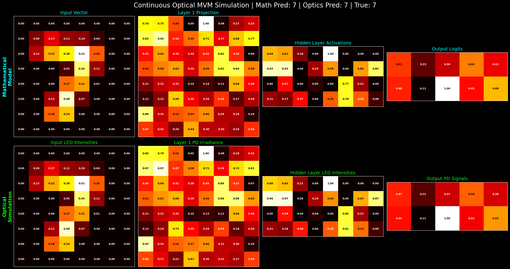
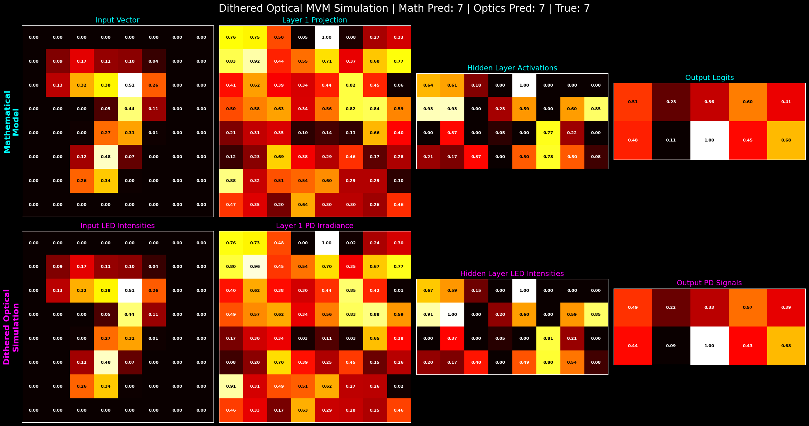
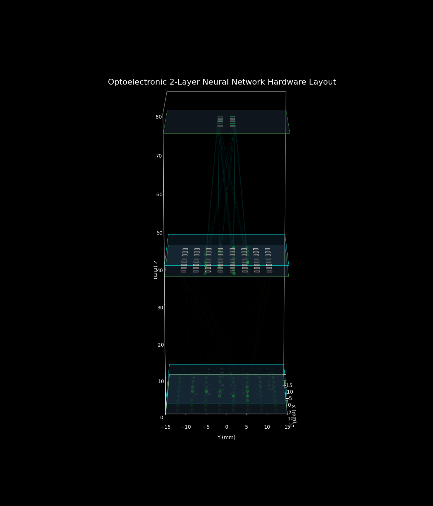
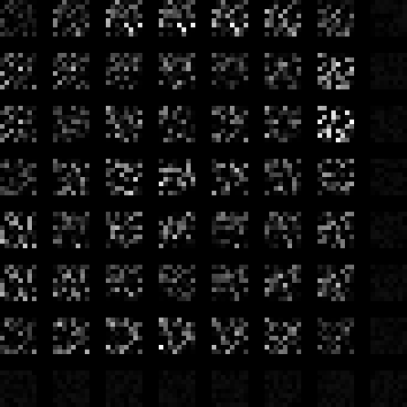
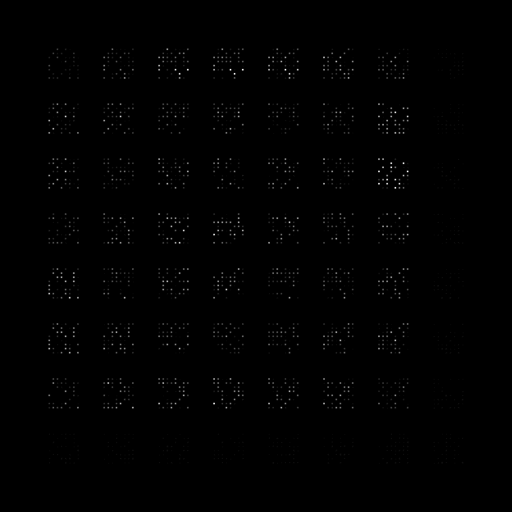
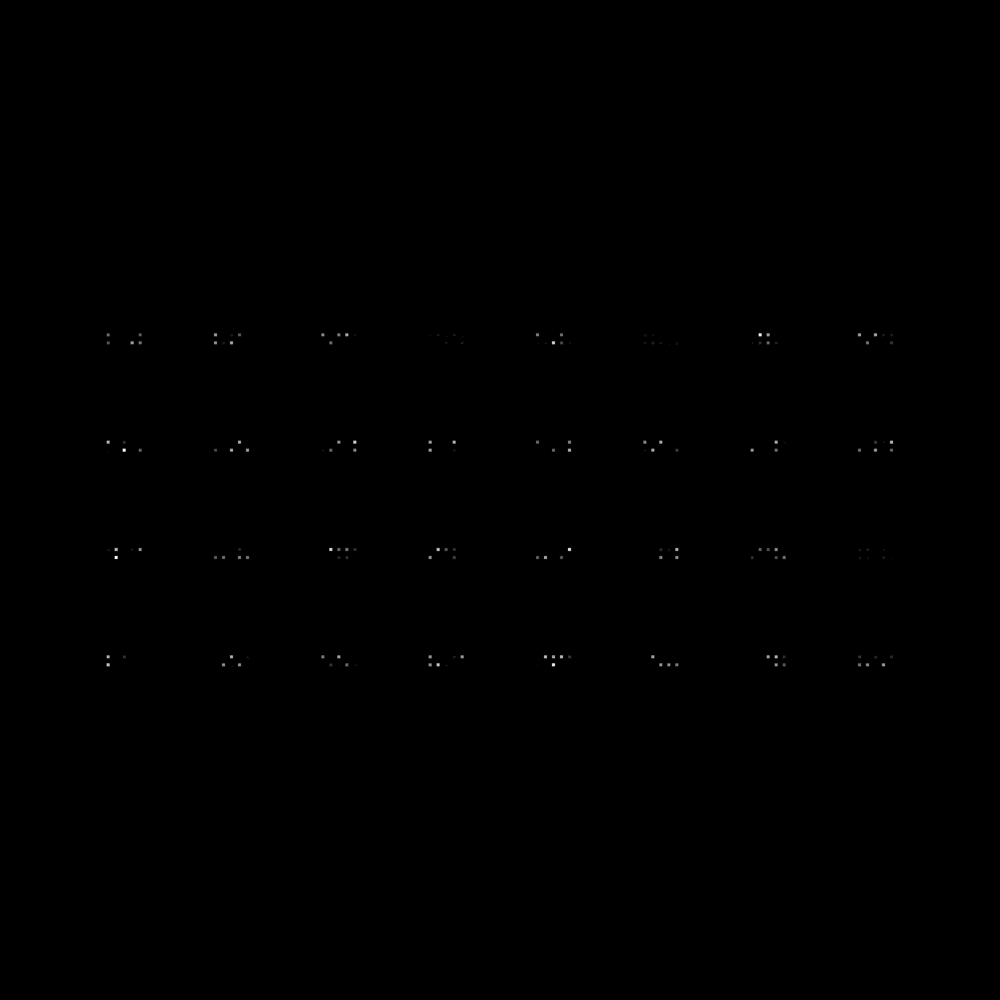

# Optical Neural Network Simulation — IMSEAM

An end-to-end design and simulation pipeline for an **optoelectronic MNIST classifier**: a two-layer neural network whose matrix–vector multiplies are performed *physically* by LEDs projecting light through binary amplitude photomasks onto photodiode arrays.

The pipeline goes all the way from **trained digital weights → fabricable photomask → simulated optical forward pass → accuracy validation**, and answers the question that matters for building the real device: *how much accuracy do you lose when continuous neural-network weights are quantized into a 1-bit, printable binary mask?*

## Headline result

The optical forward model was validated against the digital network's logits on the full 10,000-image MNIST test set:

| Model | Test accuracy |
|---|---|
| Ideal digital network (continuous weights) | **89.93%** |
| Physical dithered optics (1-bit binary mask) | **89.51%** |
| **Cost of binary mask quantization** | **0.42 pp** |

Floyd–Steinberg dithering the continuous weights into a fabricable binary photomask costs **less than half a percentage point** of accuracy — the quantization is essentially free.

*Reproduce with:* `python test_dithered_accuracy.py`

## How it works

1. **Train** a physically-constrained 64→32→10 network (non-negative light transmission via `|W|`, differential photodiode pairs for signed weights, electronic ReLU bias). → [train.py](train.py)
2. **Fabricate the mask** — scale weights to optical transmission, render continuous grayscale photomasks, then binarize with Floyd–Steinberg dithering and export to **GDSII** for photolithography. → [dither_masks.py](dither_masks.py), [make_photomask.py](make_photomask.py) → `layer1.gds`, `layer2.gds`
3. **Simulate the optics** — a 3D ray tracer models incoherent LED illumination through the binary masks onto the photodiode plane. → [ray_tracer.py](ray_tracer.py), [led_projection_3d.py](led_projection_3d.py), [full_optical_mvm_3d.py](full_optical_mvm_3d.py)
4. **Validate** the optical forward pass against the digital network, pre- and post-dithering. → [compare_math_vs_optics.py](compare_math_vs_optics.py), [compare_math_vs_optics_dithered.py](compare_math_vs_optics_dithered.py), [test_dithered_accuracy.py](test_dithered_accuracy.py)

## Results & visualizations

### Neural network logits vs. optical simulation (pre-dither)


### Neural network logits vs. simulation (post-dither)


### 3D ray-tracing visualization


### Photomask concept (continuous, prior to dither)


### Dithered binary masks (as sent to fabrication)
Layer 1 | Layer 2
:---:|:---:
 | 

## Running it

```bash
pip install torch torchvision numpy pillow matplotlib gdspy
python train.py                     # train the digital network → mnist_64x64_weights.pth
python dither_masks.py              # generate binary photomasks + GDS files
python test_dithered_accuracy.py    # validate optical accuracy vs. digital
```

---

**Aayan Shah**
Colby '28 · Dartmouth '29
